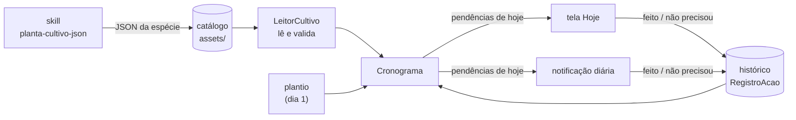
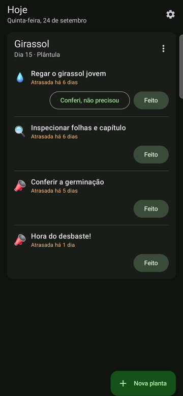
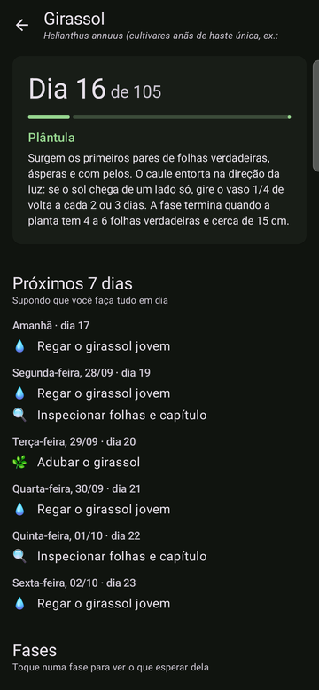
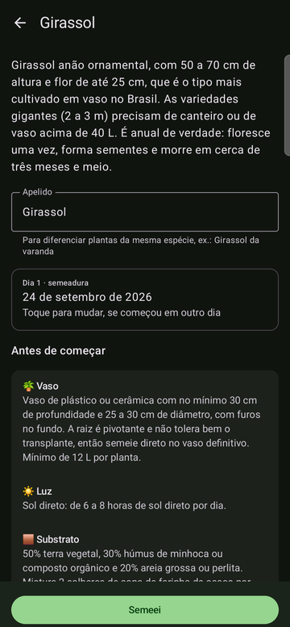
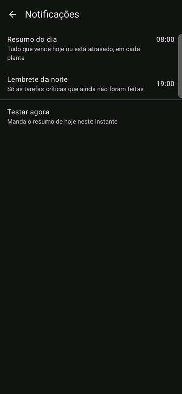

# 🌱 Jardim

[](https://github.com/GuiMartins/jardim/actions/workflows/testes.yml)


Acompanhamento de plantas em casa. Você escolhe a planta e diz em que dia
plantou; o app monta a linha do tempo dela e cobra cada rega, adubação e
colheita até você marcar como feita.

*Meio app de gravidez ("dia 15: a raiz está engrossando"), meio app de
hábitos (lembrete todo dia até concluir).*

## Como funciona



Cada espécie é um JSON com as fases da vida da planta, tarefas recorrentes,
alertas únicos e eventos por época do ano. O app não grava ocorrências
futuras: a agenda é **calculada** a partir do JSON, da data do plantio e do
histórico do que já foi feito. Por isso as perenes, que regam para sempre,
não são problema, e errar a data do plantio se corrige mudando um campo.

## Regras da cobrança

| Tipo | Aparece | Some |
|---|---|---|
| **Tarefa recorrente** (rega, adubação, colheita…) | no dia de início; depois, `frequência` dias após a última vez que foi feita | quando é feita (ou conferida, se for rega), ou quando a janela dela termina |
| **Alerta único** (desbaste, primeira colheita…) | no dia de disparo | quando é feito |
| **Evento sazonal** (poda de inverno, proteger do frio…) | no dia 1 do mês, se a planta já existia | quando é feito, ou quando o mês acaba |

- **Atraso não acumula.** Esqueceu a rega por uma semana? Aparece *uma* rega
  com 7 dias de atraso, não quatro regas empilhadas.
- **Rega tem dois botões**: "Feito" e "Conferi, não precisou". A rega do
  girassol é condicional ("enfie o dedo; se estiver úmido, espere"), então
  conferir também reinicia a contagem; o histórico guarda a diferença.
- **Ressemeou?** "Ressemeei hoje" faz hoje virar o dia 1 e a agenda recomeçar;
  o histórico de antes fica guardado.
- **Fora de época** (fora de `meses_plantio`) o app só avisa, não impede.
- **Tarefa crítica** (falhar uma vez já causa dano) ganha um lembrete extra à
  noite, se ainda não foi feita.

## Planta de referência

O [girassol](app/src/main/assets/catalogo/girassol.json) é o JSON que serve de
referência para o projeto: anual de 105 dias, 6 fases, 7 tarefas (4 delas de
rega), 7 alertas, 9 pragas e 2 eventos sazonais. Cuidado em dia do plantio à
colheita, ele gera **128 ações, nunca mais de 3 no mesmo dia**. Um teste
simula o ciclo inteiro para garantir isso.

## Telas

| Hoje | Planta | Nova planta | Notificações |
|:---:|:---:|:---:|:---:|
|  |  |  |  |

- **Hoje**: um cartão por planta, com o dia do ciclo e a fase ("Dia 15 ·
  Plântula") e as pendências de hoje e as atrasadas, críticas primeiro. Toque
  numa pendência para ver as instruções; "Feito" tem desfazer na snackbar.
- **Nova planta**: busca com autocomplete, que filtra a cada letra, sem ligar
  para acento, pelo começo de qualquer palavra do nome, pelos outros nomes
  ("língua de sogra") e pelo científico, tolerando um erro de digitação
  ("girasol"). Com a busca vazia, as mais populares vêm primeiro. Cada
  planta tem uma foto do iNaturalist, para conferir que é ela antes de tocar.
  Depois,
  um resumo da planta (luz, vaso, temperatura, época) e a pergunta: **já
  semeou** (apelido, dia 1 e onde ela fica) ou **vai semear**? Quem vai
  semear vê o que juntar antes (semente ou muda, vaso, substrato, drenagem,
  lugar com luz), marca o que já tem e pode **salvar para depois**.
- **O que plantar** ("Não sei o que plantar", no topo da busca vazia): diga
  quanto sol direto bate no lugar e o maior vaso que cabe lá, e veja o que dá
  para plantar, das mais populares às menos, com o que cada uma pede ("4 h de
  sol ou mais · vaso de 5 L"). Dá para ficar só com as fáceis, só com o que
  está na época e escolher o tipo de planta. As respostas ficam guardadas.
- **Para plantar** (no fim da tela Hoje): as plantas salvas para depois, com
  o que ainda falta e a época. A **lista de compras** junta o que falta de
  todas: mudas, sementes, vasos e os insumos do substrato ("Perlita: para
  manjericão e alecrim"), descontando a **despensa**, onde você marca o que já
  tem em casa (terra vegetal, húmus, perlita, farinha de osso...). Quando a época de uma delas começa, o resumo
  da manhã avisa uma vez ("Começou a época: Girassol").
- **Planta** (toque no nome dela na tela Hoje): a linha do tempo, com "Dia 16
  de 105", barra de progresso e a fase atual; o que vem nos próximos 7 dias;
  as fases com datas; problemas comuns (sintomas e tratamento) e o histórico
  do que foi feito.
- **Notificações**: horário do resumo (8h) e do lembrete da noite (19h), e um
  botão para testar na hora.
- **Atualização**: quando sai uma release nova no GitHub, a tela Hoje mostra
  um cartão "Versão X disponível"; um toque baixa e instala por cima, sem
  perder o histórico. Na primeira vez o Android pede para liberar o Jardim
  como fonte de instalação.

## Notificações

- **De manhã**, um grupo: recolhido, ele mostra a pendência mais importante e
  o total; expandido, cada pendência tem os próprios botões ("Feito" e, na
  rega, "Não precisou"). Dá para cuidar do dia sem abrir o app.
- **À noite**, só as críticas que ainda não foram feitas, num canal mais
  insistente.
- Marcou no app, a notificação some; marcou na notificação, a tela Hoje se
  atualiza sozinha. Um botão de notificação velha não registra de novo o que
  já foi feito.
- Agendado com WorkManager: sobrevive a reinícios e não precisa de permissão
  de alarme exato. O horário é aproximado: com o celular parado de madrugada
  (Doze), o resumo das 8h sai quando o aparelho acorda. No primeiro dia real
  chegou às 08:44, quando o celular foi pego. No Samsung, vale deixar o
  Jardim como **"Sem restrições"** em Bateria, senão o sistema pode pôr o app
  para dormir depois de alguns dias sem uso.

## Tempo

O app pergunta a cidade uma vez (pela localização aproximada ou pelo nome) e,
ao plantar, onde o vaso vai ficar: ao ar livre, coberto ou dentro de casa.
Cada espécie do catálogo tem a temperatura mínima que aguenta e a máxima a
partir da qual pede cuidado. Com a previsão da [Open-Meteo](https://open-meteo.com):

| Aviso | Quando | Para quem |
|---|---|---|
| 🥶 Proteger do frio esta noite | a mínima de amanhã fica abaixo da que a planta aguenta (coberta ganha 2 °C) | ao ar livre e coberta; entra no lembrete da noite |
| 🥵 Calor forte hoje | a máxima passa do limite da planta | ao ar livre e coberta |
| 💨 Vento forte hoje | rajadas de 60 km/h ou mais | ao ar livre e coberta |
| 🌧️ Choveu ontem | 10 mm ou mais | ao ar livre: a rega continua, mas pede para conferir com o dedo |

Os avisos entram na tela Hoje, nas notificações e na previsão dos próximos 7
dias da planta. Sem internet, vale a última previsão baixada.

## Catálogo e busca

O app foi feito para aguentar o catálogo das 1000 plantas mais populares do
Brasil sem ficar lento:

- A lista e a busca leem só um **índice** (`catalogo/indice.json`), gerado no
  build a partir dos JSONs de espécie. O JSON inteiro de uma planta só é lido
  quando você a escolhe.
- Se existir `dados/plantas-populares.json` (o levantamento das populares), o
  índice ganha os **outros nomes**, a **categoria** e o **ranking de
  popularidade** de cada planta.
- Medido com 1000 plantas: o índice tem 253 KB (37 KB comprimido no APK) e
  cada letra digitada custa ~1,3 ms na JVM. O catálogo inteiro soma uns
  5 MB ao APK.

### Fotos

As fotos vêm do [iNaturalist](https://www.inaturalist.org) e não estão no APK:
o índice guarda o endereço da miniatura, e o app baixa cada uma quando a linha
aparece na busca e a guarda em 160 px (~5 KB). Sem internet, as que nunca
apareceram mostram o emoji da categoria (🥬 🌸 🌵 🌴…).

`python dados/fotos.py` escolhe a foto de cada espécie entre as da página dela e
as de exemplares cultivados no Brasil, só com licença que permite recortar (CC0,
BY, BY-SA, BY-NC, BY-NC-SA), e guarda autor e licença em `dados/fotos.json`. A
escolha automática confere o nome científico, mas é revisada à mão numa página
com todas as miniaturas (`dados/cache/fotos/revisao.html`); as decisões ficam em
`dados/fotos.csv`.

Para testar volume sem pôr nada no repositório:
`./gradlew assembleDebug -PcatalogoExtra=<pasta com catalogo/*.json>`.

## Estrutura

```
motor/    Kotlin puro: leitura e validação do JSON, cálculo da agenda
app/      Android (Jetpack Compose); catálogo em app/src/main/assets/catalogo/
dados/    levantamento das plantas populares e geração do catálogo em lote
.claude/  skill planta-cultivo-json, que escreve o JSON de cada espécie
```

O `motor` não depende do Android, então toda a lógica de "o que fazer hoje"
roda em testes na JVM, em segundos, sem emulador.

## Adicionar uma planta

1. No Claude Code, aberto neste repositório: `/planta-cultivo-json Manjericão`
   (a skill mora em [`.claude/skills/planta-cultivo-json/`](.claude/skills/planta-cultivo-json/SKILL.md))
2. Salve a resposta em `app/src/main/assets/catalogo/manjericao.json`
3. Rode `./gradlew :motor:test`: o teste do catálogo recusa qualquer JSON fora
   do formato. O índice da busca se refaz sozinho no próximo build.

Em lote, `python dados/gerar_catalogo.py` roda a skill para cada planta da
lista de populares que ainda não está no catálogo, uma sessão do Claude Code
por planta, e só grava o JSON que passa no `validar.py` da skill. Opções:
`python dados/gerar_catalogo.py --help`.

Para escolher a próxima, [`dados/plantas-populares.json`](dados/plantas-populares.json)
lista as 1000 plantas cultivadas mais populares do Brasil, com nome, categoria e
o nome de arquivo sugerido (`no_catalogo` marca as que o app já tem). A nota
mistura observações de exemplares cultivados no iNaturalist com visitas ao
artigo na Wikipedia em português. Para refazer: `python dados/levantamento.py`;
nomes, categorias e exclusões ficam em `dados/curadoria.csv`.

## Rodando

```bash
./dev.sh test       # testes do motor
./dev.sh run        # build release + instala + abre no celular conectado
./dev.sh run-debug  # o mesmo em debug (inspecionar o banco, ferramentas do Compose)
./dev.sh print hoje # print da tela ligada do celular (funciona no dobrável)
./dev.sh release    # testes + tag vX.Y.Z + release no GitHub com o APK
```

Cada versão instalada no celular vira uma [release](https://github.com/GuiMartins/jardim/releases),
com a tag tirada do `versionName` de `app/build.gradle.kts` (suba ele e o
`versionCode` antes). Os testes rodam no GitHub Actions a cada push.

Precisa do JDK 17 e do Android SDK (`local.properties` com `sdk.dir`). O
banco é Room, com o esquema de cada versão em `app/schemas/`.

O celular recebe o build **release** (R8), assinado com a chave de
desenvolvimento desta máquina. Medido no Galaxy Z Fold7, com 1000 plantas:

| | debug | release |
|---|---|---|
| Abrir o app | 428 ms | 124 ms |
| Carregar o índice do catálogo | 336 ms | 28 ms |
| Quadro durante a busca (mediana) | 18 ms | 5–6 ms |
| APK | 17,9 MB | 7,8 MB |

## Roteiro

- [x] **Etapa 1**: stack e regras de produto
- [x] **Etapa 2**: motor (leitura e validação do JSON, agenda) com testes
- [x] **Etapa 3**: banco local (plantios e histórico), tela "Hoje" e "Nova planta"
- [x] **Etapa 4**: notificações (resumo da manhã, lembrete da noite, botões na notificação)
- [x] **Etapa 5**: linha do tempo da planta (agora, próximos dias, fases, problemas, histórico)
- [x] **Etapa 6**: avisos do tempo (geada, calor, vento e chuva pela previsão da cidade e pelo lugar de cada vaso)
- [x] **Etapa 7**: nova planta em etapas (resumo, preparo com o que juntar, "Para plantar" e aviso de começo da época)
- [x] **Etapa 8**: "O que plantar", a descoberta pelo sol e pelo espaço que a pessoa tem
- [x] **Etapa 9**: Minha despensa e lista de compras (insumos do substrato extraídos do catálogo)
