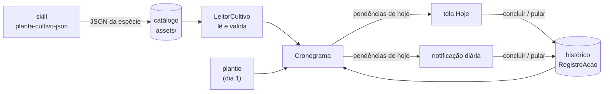

# 🌱 Jardim


Acompanhamento de plantas em casa. Você escolhe a planta e diz em que dia
plantou; o app monta a linha do tempo dela e cobra cada rega, adubação e
colheita até você marcar como feita.

*Meio app de gravidez ("dia 15: a raiz está engrossando"), meio app de
hábitos (lembrete todo dia até concluir).*

## Como funciona



Cada espécie é um JSON com as fases da vida da planta, tarefas recorrentes,
alertas únicos e eventos por época do ano. O app não grava ocorrências
futuras: a agenda é **calculada** a partir do JSON, da data do plantio e do
histórico do que já foi feito. Por isso as perenes, que regam para sempre,
não são problema, e errar a data do plantio se corrige mudando um campo.

## Regras da cobrança

| Tipo | Aparece | Some |
|---|---|---|
| **Tarefa recorrente** (rega, adubação, colheita…) | no dia de início; depois, `frequência` dias após a última vez que foi feita | quando é feita ou pulada, ou quando a janela dela termina |
| **Alerta único** (desbaste, primeira colheita…) | no dia de disparo | quando é feito |
| **Evento sazonal** (poda de inverno, proteger do frio…) | no dia 1 do mês, se a planta já existia | quando é feito, ou quando o mês acaba |

- **Atraso não acumula.** Esqueceu a rega por uma semana? Aparece *uma* rega
  com 7 dias de atraso, não quatro regas empilhadas.
- **Tarefa crítica** (pular uma vez já causa dano) ganha um lembrete extra à
  noite.
- Depois de **7 dias de atraso**, o app pergunta se a planta ainda está viva
  em vez de continuar cobrando.

## Estrutura

```
motor/   Kotlin puro: leitura e validação do JSON, cálculo da agenda
app/     Android (Jetpack Compose); catálogo em app/src/main/assets/catalogo/
```

O `motor` não depende do Android, então toda a lógica de "o que fazer hoje"
roda em testes na JVM, em segundos, sem emulador.

## Adicionar uma planta

1. No Claude Code: `/planta-cultivo-json Manjericão`
2. Salve a resposta em `app/src/main/assets/catalogo/manjericao.json`
3. Rode `./gradlew :motor:test`: o teste do catálogo recusa qualquer JSON fora
   do formato.

## Rodando

```bash
./gradlew :motor:test      # testes do motor
./gradlew assembleDebug    # APK debug
adb install -r app/build/outputs/apk/debug/app-debug.apk
```

Precisa do JDK 17 e do Android SDK (`local.properties` com `sdk.dir`).

## Roteiro

- [x] **Etapa 1**: stack e regras de produto
- [x] **Etapa 2**: motor (leitura e validação do JSON, agenda) com testes
- [ ] **Etapa 3**: banco local (plantios e histórico) e tela "Hoje"
- [ ] **Etapa 4**: notificações (resumo diário, lembrete da noite, botão "Concluir")
- [ ] **Etapa 5**: linha do tempo da planta
