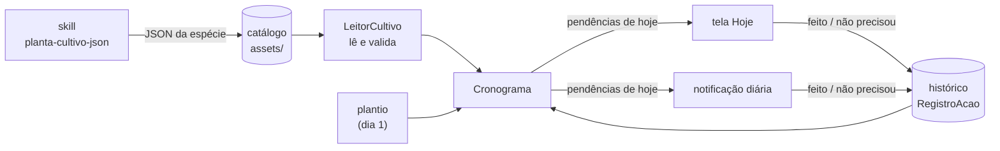

# 🌱 Jardim


Acompanhamento de plantas em casa. Você escolhe a planta e diz em que dia
plantou; o app monta a linha do tempo dela e cobra cada rega, adubação e
colheita até você marcar como feita.

*Meio app de gravidez ("dia 15: a raiz está engrossando"), meio app de
hábitos (lembrete todo dia até concluir).*

## Como funciona



Cada espécie é um JSON com as fases da vida da planta, tarefas recorrentes,
alertas únicos e eventos por época do ano. O app não grava ocorrências
futuras: a agenda é **calculada** a partir do JSON, da data do plantio e do
histórico do que já foi feito. Por isso as perenes, que regam para sempre,
não são problema, e errar a data do plantio se corrige mudando um campo.

## Regras da cobrança

| Tipo | Aparece | Some |
|---|---|---|
| **Tarefa recorrente** (rega, adubação, colheita…) | no dia de início; depois, `frequência` dias após a última vez que foi feita | quando é feita (ou conferida, se for rega), ou quando a janela dela termina |
| **Alerta único** (desbaste, primeira colheita…) | no dia de disparo | quando é feito |
| **Evento sazonal** (poda de inverno, proteger do frio…) | no dia 1 do mês, se a planta já existia | quando é feito, ou quando o mês acaba |

- **Atraso não acumula.** Esqueceu a rega por uma semana? Aparece *uma* rega
  com 7 dias de atraso, não quatro regas empilhadas.
- **Rega tem dois botões**: "Feito" e "Conferi, não precisou". A rega do
  girassol é condicional ("enfie o dedo; se estiver úmido, espere"), então
  conferir também reinicia a contagem; o histórico guarda a diferença.
- **Ressemeou?** "Ressemeei hoje" faz hoje virar o dia 1 e a agenda recomeçar;
  o histórico de antes fica guardado.
- **Fora de época** (fora de `meses_plantio`) o app só avisa, não impede.
- **Tarefa crítica** (falhar uma vez já causa dano) vai ganhar um lembrete
  extra à noite, na etapa 4.

## Planta de referência

O [girassol](app/src/main/assets/catalogo/girassol.json) é o JSON que serve de
referência para o projeto: anual de 105 dias, 6 fases, 7 tarefas (4 delas de
rega), 7 alertas, 9 pragas e 2 eventos sazonais. Cuidado em dia do plantio à
colheita, ele gera **128 ações, nunca mais de 3 no mesmo dia**. Um teste
simula o ciclo inteiro para garantir isso.

## Telas

- **Hoje**: um cartão por planta, com o dia do ciclo e a fase ("Dia 15 ·
  Plântula") e as pendências de hoje e as atrasadas, críticas primeiro. Toque
  numa pendência para ver as instruções; "Feito" tem desfazer na snackbar.
- **Nova planta**: o catálogo, com dificuldade, duração do ciclo e se é boa
  época; depois apelido, data do dia 1 e o que preparar antes (vaso, luz,
  substrato, drenagem).

## Estrutura

```
motor/   Kotlin puro: leitura e validação do JSON, cálculo da agenda
app/     Android (Jetpack Compose); catálogo em app/src/main/assets/catalogo/
```

O `motor` não depende do Android, então toda a lógica de "o que fazer hoje"
roda em testes na JVM, em segundos, sem emulador.

## Adicionar uma planta

1. No Claude Code: `/planta-cultivo-json Manjericão`
2. Salve a resposta em `app/src/main/assets/catalogo/manjericao.json`
3. Rode `./gradlew :motor:test`: o teste do catálogo recusa qualquer JSON fora
   do formato.

## Rodando

```bash
./dev.sh test       # testes do motor
./dev.sh run        # build + instala + abre no celular ou emulador conectado
./dev.sh emulator   # sobe o emulador
```

Precisa do JDK 17 e do Android SDK (`local.properties` com `sdk.dir`). O
banco é Room, com o esquema de cada versão em `app/schemas/`.

## Roteiro

- [x] **Etapa 1**: stack e regras de produto
- [x] **Etapa 2**: motor (leitura e validação do JSON, agenda) com testes
- [x] **Etapa 3**: banco local (plantios e histórico), tela "Hoje" e "Nova planta"
- [ ] **Etapa 4**: notificações (resumo diário, lembrete da noite, botão "Concluir")
- [ ] **Etapa 5**: linha do tempo da planta
